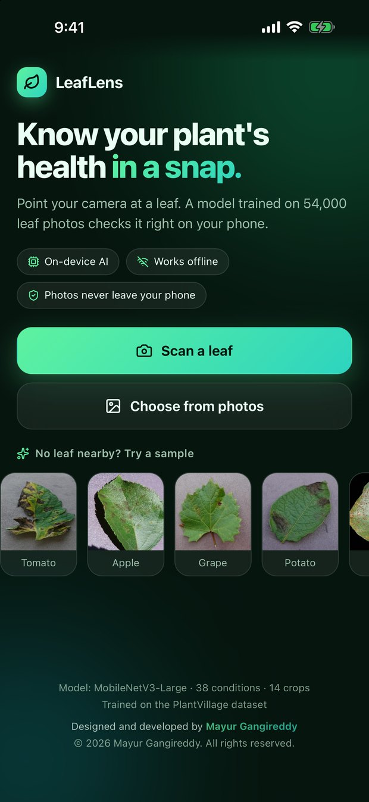
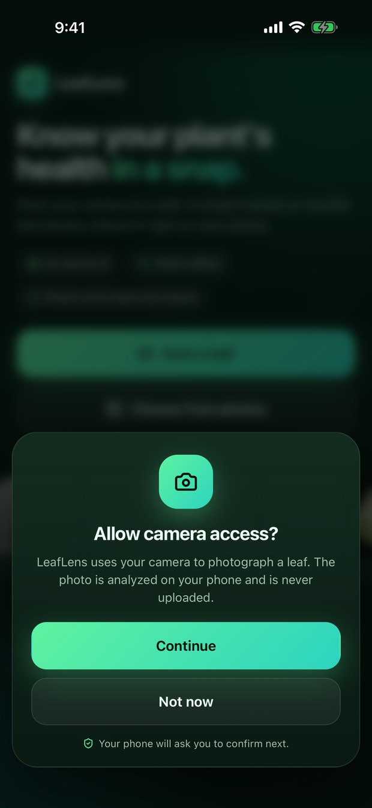
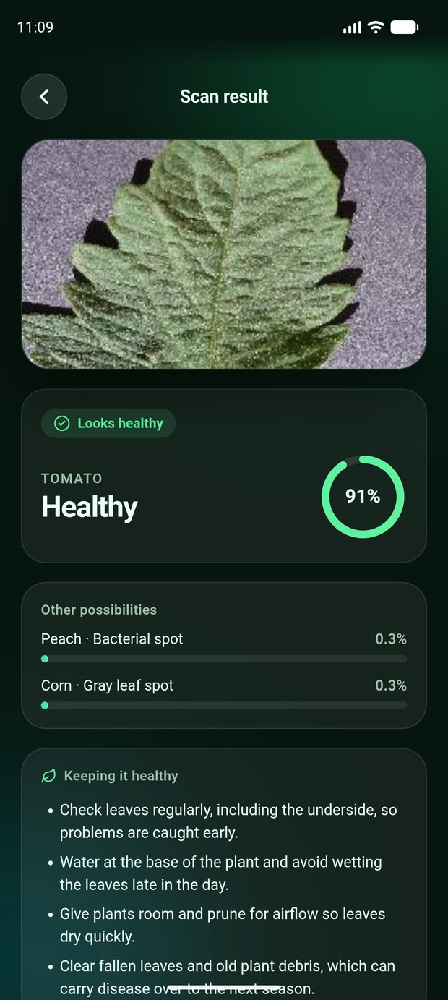
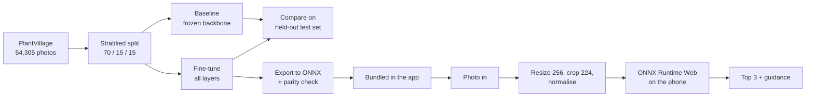
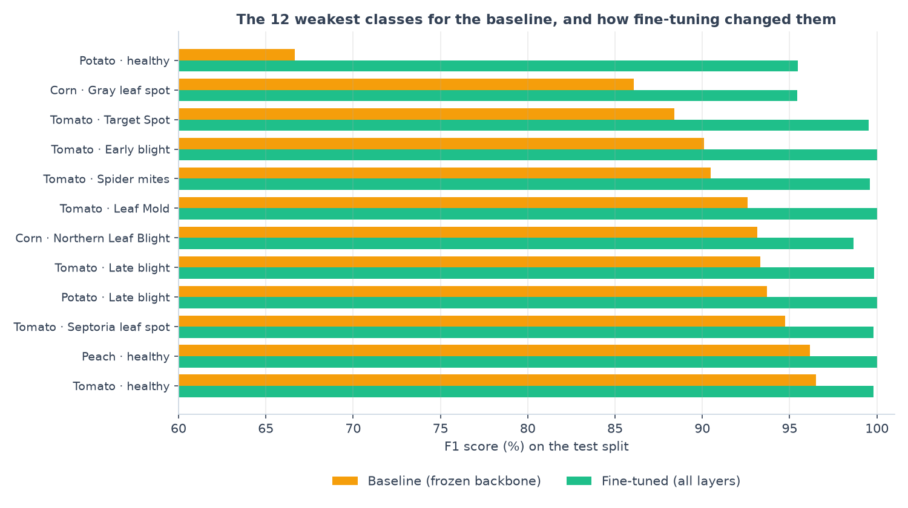
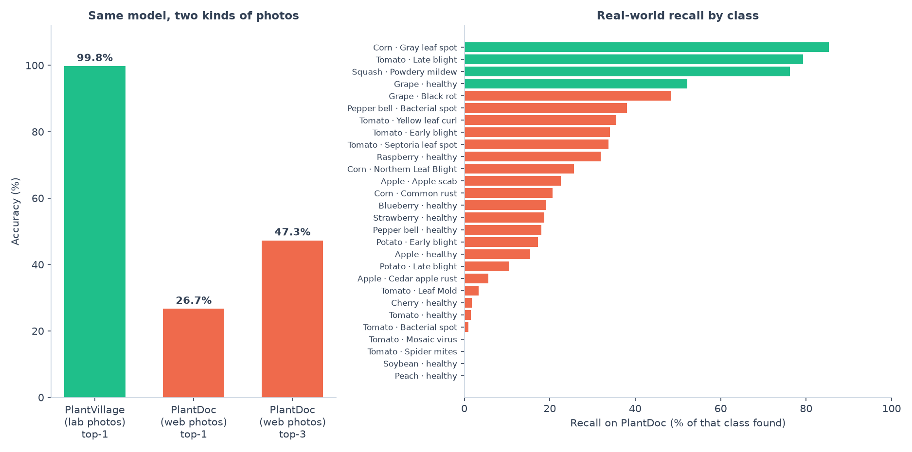
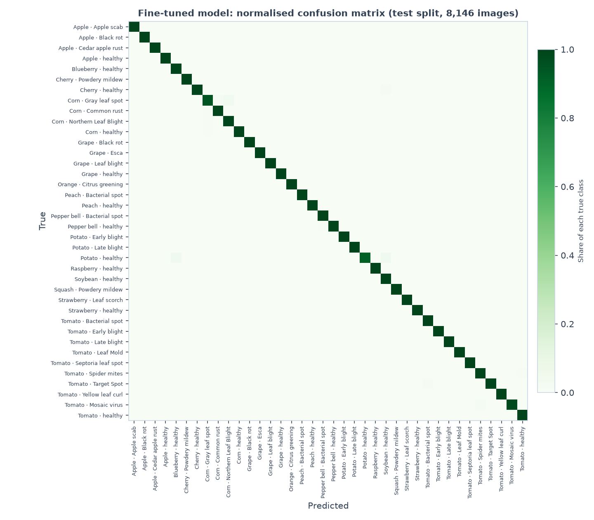

<div align="center">


# LeafLens

**Plant disease detection that runs on the phone.** Point a camera at a leaf and get an answer in a fraction of a second, with no server, no upload and no internet.

[](https://github.com/gangireddymayur/leaflens/actions/workflows/ci.yml)


**[⬇ Download the Android APK](https://github.com/gangireddymayur/leaflens/releases/latest)** &nbsp;·&nbsp; iOS: build from source (steps below)

<br/>







<sub>Home, permission pop-up, a disease result and its guidance (iPhone simulator), and a healthy-leaf result (Android emulator).</sub>

</div>

---

## Why this project

A farmer in a field often has no signal. A cloud API cannot help there, and uploading photos of someone's crop is a privacy question in its own right. LeafLens puts the trained model **inside the app**, so a scan works offline and the photo never leaves the phone.

It is also a complete machine-learning project in one repository: data preparation, training with a baseline to beat, honest evaluation, model export with a parity check, and a real iOS and Android app that ships the model.

## At a glance

| | |
|---|---|
| **Task** | Classify a leaf photo into 38 conditions across 14 crops |
| **Model** | MobileNetV3-Large (ImageNet-pretrained, fine-tuned on lab and real-world photos), 17 MB as ONNX |
| **Data** | PlantVillage (54,305 lab photos) plus PlantDoc (2,572 real-world web photos), with fixed-seed splits. [Sources and licences](#data) |
| **Test result** | **Lab photos: 99.1%.** **Real-world photos: 69.3% top-1, 89.5% top-3** on 514 held-out PlantDoc photos |
| **Runs on** | iOS, Android and the browser, from one codebase (Capacitor, ONNX Runtime Web) |
| **Before real-world training** | The lab-trained model scored only 26.7% on PlantDoc web photos, which is why the model was retrained (see [below](#real-world-test-plantdoc)) |
| **Privacy** | Fully on-device. No network request is made during a scan |

## What the app does

- **Scan or choose:** take a photo, pick one from the library, or tap one of 8 bundled sample leaves.
- **Clear result:** the crop, the condition, a confidence ring and the next two possibilities.
- **About this condition:** for each of the 26 diseases, what causes it, how it spreads, what to look for, and general steps to manage it.
- **Honest by design:** below 60% confidence the app says it is not sure and shows no advice, and every result carries a limitations note.
- **Download report:** one tap makes a one-page PDF of the scan (photo, result, guidance and limitations). It is built on the phone and handed to the system share sheet, so you choose where it goes.
- **Smooth on fast screens:** the app asks for the display's highest refresh rate (120 Hz where available). The setting is in place, but I have not yet verified it on a 120 Hz phone.
- **Polite permissions:** a friendly pop-up explains why the camera is needed, then the system dialog follows.
- **Native feel:** dark, glassy interface, safe-area aware, Android back button support and a custom app icon.

## How it works



1. **Train** on a Mac or a Kaggle GPU with PyTorch. A frozen-backbone baseline comes first, so the gain from fine-tuning is measured and not assumed.
2. **Export** to ONNX and verify that the exported model gives the same answers as PyTorch (maximum difference about 3e-6).
3. **Ship** the model inside the app. The app prepares each photo exactly the way training did, runs the model locally and shows the result.

The app's JavaScript image preparation was checked against the Python pipeline on 8 held-out photos: identical predictions and the same probabilities to three decimal places.

## Data

Every photo behind this project comes from **public, openly licensed datasets**. No photos of my own, and no data from any employer or client, were used.

| Dataset | What it is | Where I got it | Licence | How it was used |
|---|---|---|---|---|
| **PlantVillage** | 54,305 lab photos of single leaves on plain backgrounds, 38 classes (14 crops) | [Hugging Face copy, `BrandonFors/Plant-Diseases-PlantVillage-Dataset`](https://huggingface.co/datasets/BrandonFors/Plant-Diseases-PlantVillage-Dataset) (parquet files, 852 MB). Original project: [spMohanty/PlantVillage-Dataset](https://github.com/spMohanty/PlantVillage-Dataset) | CC0, as stated on that copy's dataset card | Training (70%), validation (15%) and the lab test split (15%) |
| **PlantDoc** | 2,572 real-world photos scraped from the web, 28 class folders (27 classes plus a 2-photo spider-mite folder), 13 crops | [pratikkayal/PlantDoc-Dataset](https://github.com/pratikkayal/PlantDoc-Dataset) (the classification version, about 1 GB) | CC BY 4.0 | Real-world training (60%), validation (20%) and the held-out real-world test (20%) |
| **ImageNet** | 1.28 million everyday photos in 1,000 classes | Pretrained MobileNetV3-Large weights from torchvision (`MobileNet_V3_Large_Weights.IMAGENET1K_V2`) | See the torchvision and ImageNet terms | The starting point, before any plant data |

**Where the datasets are from.** PlantVillage was released by Hughes and Salathé (2015) so that researchers could build plant-disease tools. PlantDoc was collected by researchers at an Indian Institute of Technology because PlantVillage's lab photos do not look like real fields. See [Credits](#credits) for the papers.

**How they were split.** Both splits use a fixed random seed so every run is repeatable.

| | Train | Validation | Test |
|---|---|---|---|
| PlantVillage (seed 42) | 38,013 | 8,146 | 8,146 |
| PlantDoc (seed 1234, stratified by class) | 1,544 | 514 | 514 |

The real-world training run also showed each PlantDoc training photo three times per epoch, mixed with 8,000 fresh PlantVillage photos. The PlantDoc test photos were never used for training or for choosing an epoch. The list of exactly which photos went into each PlantDoc split is in [`docs/plantdoc_split.json`](docs/plantdoc_split.json).

**Other content that is not from a dataset.** The 8 sample leaves inside the app are PlantVillage test-split photos. The "About this condition" guidance was written by me from general plant-pathology knowledge, not taken from a dataset, and it has not been reviewed by an agronomist.

**Getting the data yourself.** The photos are not stored in this repository.

```bash
# PlantVillage: download the three parquet files, then turn them into class folders
BASE=https://huggingface.co/datasets/BrandonFors/Plant-Diseases-PlantVillage-Dataset/resolve/main/data
mkdir -p data/raw/hf && cd data/raw/hf
for f in test-00000-of-00001 train-00000-of-00002 train-00001-of-00002; do curl -L -O "$BASE/$f.parquet"; done
cd ../../..
PYTHONPATH=src python -m plantdx.prepare_data --parquet-dir data/raw/hf --out-dir data/plantvillage

# PlantDoc
git clone --depth 1 https://github.com/pratikkayal/PlantDoc-Dataset.git data/raw/plantdoc
```

## Results

| Model | Test accuracy | Test macro-F1 | Mistakes (of 8,146) | Training time |
|---|---|---|---|---|
| Linear baseline (frozen backbone, 3 epochs) | 97.45% | 96.23% | 208 | 4.3 min |
| **Fine-tuned (all layers, 8 epochs)** | **99.78%** | **99.58%** | **18** | 23.5 min |

Training ran on the GPU of an Apple M5 Pro (PyTorch MPS). The test split was never used for training or for choosing the checkpoint.

<p align="center"></p>

Fine-tuning helped most where the baseline struggled. The rare class `Potato · healthy` (only 152 images in the whole dataset) went from F1 66.7% to 95.5%.

<p align="center"></p>

The most common mistake of the fine-tuned model is confusing two corn leaf diseases (gray leaf spot predicted as northern leaf blight, 3 images), which look alike even to people.

### Real-world test (PlantDoc)

The 99.8% above is on lab photos. To see what happens on messier pictures, I tested the model on **PlantDoc**: 2,572 photos scraped from the web, in 28 classes that map onto this model's classes (Singh et al., 2020, CC BY 4.0).

**Step 1: the lab-trained model fell apart.** It scored **26.7%** top-1 and 47.3% top-3. It had learned plain-background cues, and it kept falling back on a few "favourite" answers.

**Step 2: train on real-world photos too.** PlantDoc was split once, with a fixed seed, into **1,544 photos to train on, 514 to pick the best epoch and 514 locked away for the final score**. The model was continued from the lab-trained one on a mix: every real-world training photo three times per epoch with heavy augmentation (crops, rotation, blur, colour shifts, random erasing), plus 8,000 fresh lab photos per epoch.

| Experiment | PlantDoc held-out top-1 | Top-3 | Lab top-1 | Training time |
|---|---|---|---|---|
| Lab-trained only (the earlier model) | 26.7% * | 47.3% * | 99.8% | 23 min |
| **MobileNetV3, mixed training (shipped)** | **69.3%** | **89.5%** | 99.1% | 14 min |
| EfficientNet-B0, mixed training | 70.2% | 87.4% | 99.2% | 27 min |
| MobileNetV3 with the whole image squeezed to 224 px | 66.7% | 87.2% | n/a | n/a |

<sub>* measured on all 2,572 PlantDoc photos (none of which that model had seen).</sub>

**I stopped here on purpose.** Validation accuracy rose quickly, then stayed between 70% and 72% for most of the run. A bigger backbone (EfficientNet-B0) landed in the same place, and the gap between the two is smaller than the test's own margin of error (about 4 points on 514 photos). When two different models stop at the same score, the limit is the **amount and quality of real-world training photos** (only 1,544), not the model. More real-world photos is what would move it next.

<p align="center"></p>

**What the shipped model does on the 514 held-out real-world photos**

| Measure | Result |
|---|---|
| Top-1 / top-3 accuracy | **69.3%** / **89.5%** |
| Healthy leaves called healthy (any crop / exact class) | 90.5% / 80.5% of 169 |
| Diseased leaves wrongly called healthy | 4.3% of 345 |
| Photos where the app says "Not sure" (below 60%) | 31.1% |
| Accuracy on the answers it gives / on the "Not sure" ones | **81.1%** / 43.1% |
| Median confidence when right / when wrong | 84% / 55% |

- **Better, still not reliable.** About 7 in 10 photos are named correctly and the right answer is in the top 3 for about 9 in 10. When the app commits to an answer, it is right about 8 times in 10, and it says "Not sure" instead of guessing on the rest.
- **Weak spots remain.** Per class, Tomato bacterial spot (9%), corn gray leaf spot (21%) and tomato early blight (33%) are still often missed.
- **Caveats.** The test is small (about 19 photos per class). It is the same kind of photo as the training set (web images), so a phone photo of a real plant may behave differently, and I have not measured that. PlantDoc is web-scraped, so a few labels may be noisy.

Treat the app as a **hint, not a diagnosis**.

<details>
<summary>Full confusion matrix</summary>
<p align="center"></p>
</details>

## Read this before trusting the numbers

Being straight about limits is part of the project.

- **The lab score is optimistic.** PlantVillage photos are taken on plain lab backgrounds, and the same leaf can appear in several images, so near-duplicates may sit in both the training and test splits. On real-world web photos the lab-trained model scored 26.7%; after training on real-world photos too, the shipped model scores 69.3% on held-out ones. Details above.
- **The real-world number comes from a small test** (514 photos, about 4 points of margin) of the same kind of photo it trained on. Phone photos of real plants may differ.
- **Only 14 crops and 38 conditions.** It does not cover staples such as rice, wheat or cotton, and any photo that is not a leaf will still get a (meaningless) answer.
- **Confidence looks modest on purpose.** The model was trained with label smoothing, so even correct predictions show roughly 85 to 92%. That is deliberate, and it avoids overconfident answers.
- **Speed is not a phone number yet.** Timings in the app were about 20 ms in a Mac simulator and 60 ms on one real Android phone (a single measurement). More devices are needed before quoting a speed.
- **The guidance is general information, not advice.** It is written from standard plant-pathology references and should be reviewed by an agricultural expert before real use.

## Run it

### 1. The app (the model is included)

**Quickest on Android:** install the APK from the [latest release](https://github.com/gangireddymayur/leaflens/releases/latest). It is a debug-signed build, so Android may ask you to allow installs from your browser or Files app.

Requires Node.js 22 or newer.

```bash
git clone https://github.com/gangireddymayur/leaflens.git
cd leaflens/app
npm install
npm run dev            # open the printed local URL in a browser
```

For a phone or emulator:

```bash
npm run build && npx cap sync
npx cap open ios       # Xcode: pick a simulator or device, press Run
npx cap open android   # Android Studio: pick an emulator or device, press Run
```

The iPhone simulator has no camera, so use **Choose from photos** or a bundled sample there. The Android emulator and real phones can use the camera.

### 2. Train the model yourself

Needs Python 3.11 or 3.12. On a Mac the Apple GPU is used automatically. On Kaggle, open `notebooks/kaggle_train.ipynb` with a GPU.

```bash
pip install uv
uv venv --python 3.12 .venv
uv pip install --python .venv/bin/python -r requirements.txt
export PYTHONPATH=src

# download a PlantVillage copy as parquet files, then turn it into class folders
.venv/bin/python -m plantdx.prepare_data --parquet-dir data/raw/hf --out-dir data/plantvillage

.venv/bin/python -m plantdx.train --data-dir data/plantvillage --mode linear   --epochs 3 --out-dir runs/linear
.venv/bin/python -m plantdx.train --data-dir data/plantvillage --mode finetune --epochs 8 --out-dir runs/finetune
```

### 3. Put your model into the app

The app needs two files in `app/public/model/`:

| File | What it is |
|---|---|
| `plant_model.onnx` | The model. One input named `input` (float32, shape `[N, 3, 224, 224]`, ImageNet mean and std normalisation) and one output named `logits` (`[N, 38]`). |
| `labels.json` | The class names, in the same order as the model's outputs. |

```bash
.venv/bin/python -m plantdx.export_onnx --checkpoint runs/finetune/best.pt --out-dir app/public/model
```

The export script checks that the ONNX file matches PyTorch before it finishes. If you change the classes, also update `app/src/lib/knowledge.js`, which holds the guidance for each condition. Rebuild with `npm run build && npx cap sync`.

### Should the model live in git?

For a 17 MB file, yes: it keeps the project runnable straight after cloning. Larger or frequently retrained models belong in **GitHub Releases** (or Git LFS), because every committed version stays in history forever. The `*.onnx` files are git-ignored except the one the app ships with.

## Project structure

```
src/plantdx/        data, training, evaluation, ONNX export (PyTorch)
tests/              unit tests for splitting and metrics
notebooks/          Kaggle training notebook
app/                the LeafLens app (React + Capacitor)
  src/lib/          on-device inference, camera, per-condition guidance
  public/model/     the ONNX model and class labels
  ios/  android/    native projects
docs/               screenshots and result charts
```

## Reproduce the real-world work

```bash
git clone --depth 1 https://github.com/pratikkayal/PlantDoc-Dataset.git data/raw/plantdoc
export PYTHONPATH=src

# train on lab + real-world photos (continues from the lab-trained model)
python -m plantdx.mixed --init runs/finetune/best.pt --out-dir runs/mixed_mnv3 --epochs 12
python -m plantdx.export_onnx --checkpoint runs/mixed_mnv3/best.pt --out-dir app/public/model

# score only the held-out real-world photos with the shipped ONNX model
python -m plantdx.real_world --plantdoc-dir data/raw/plantdoc --split-file runs/mixed_mnv3/plantdoc_split.json
```

## Tests and CI

```bash
PYTHONPATH=src python -m unittest discover -s tests -v
```

CI runs the unit tests and builds the app on every push.

## Roadmap

- [x] Training, evaluation and ONNX export with a parity check
- [x] iOS and Android app with on-device inference and condition guidance
- [x] Evaluate on real-world photos (PlantDoc) and report the drop honestly
- [x] Train with real-world photos plus stronger augmentation, and re-test on a held-out part (69.3% top-1)
- [ ] Collect more real-world photos, which is the current limit, including my own phone photos
- [ ] Verify the 120 Hz setting on a real 120 Hz phone
- [ ] Measure inference speed on real phones
- [ ] Evaluate the 4.5 MB int8 model on real images
- [ ] Add crops common in India (rice, wheat, cotton, chilli) with local data
- [ ] Regional language support (Telugu, Hindi)
- [ ] Review the guidance content with an agronomist

## Credits

- **PlantDoc** (used for testing only): Singh, Jain, Jain, Kayal, Kumawat and Batra, *PlantDoc: A Dataset for Visual Plant Disease Detection* (CoDS-COMAD 2020), CC BY 4.0.
- **PlantVillage** dataset: Hughes and Salathé, *An open access repository of images on plant health to enable the development of mobile disease diagnostics* (2015). Trained from a public CC0 copy on Hugging Face.
- **MobileNetV3**: Howard et al., *Searching for MobileNetV3* (2019), via torchvision.
- Built with PyTorch, ONNX Runtime, Capacitor, React, Vite and Framer Motion.

---

<div align="center">

**Designed and developed by [Mayur Gangireddy](https://github.com/gangireddymayur)**

© 2026 Mayur Gangireddy. All rights reserved.

</div>
