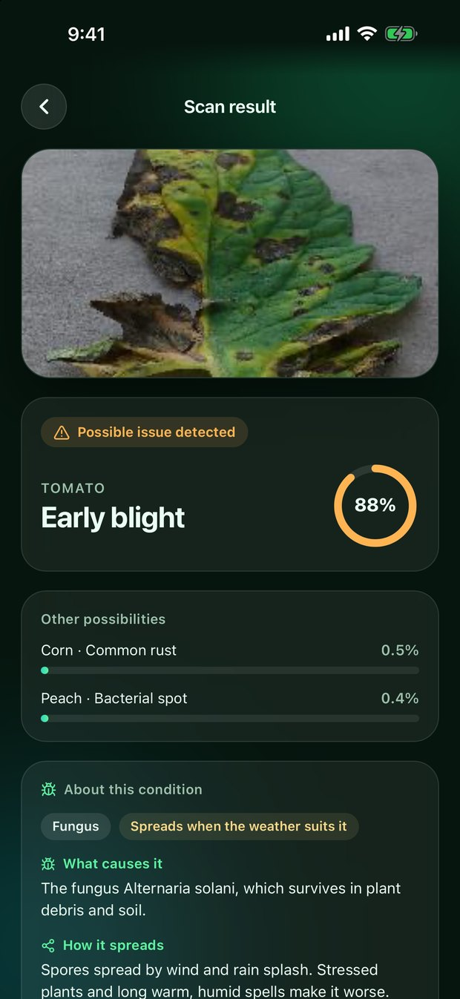
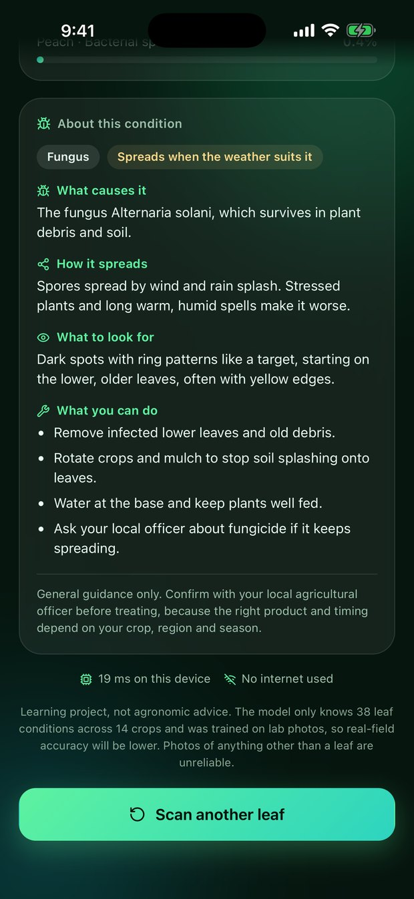
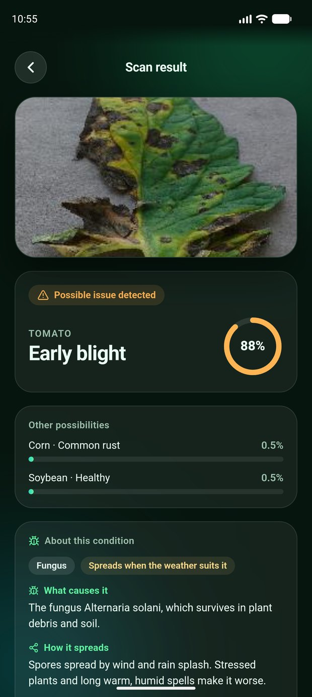
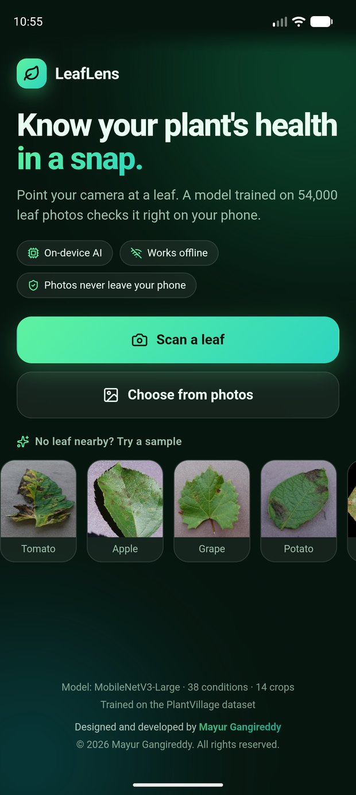
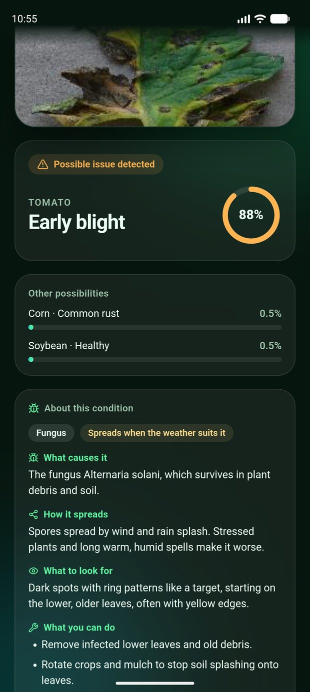
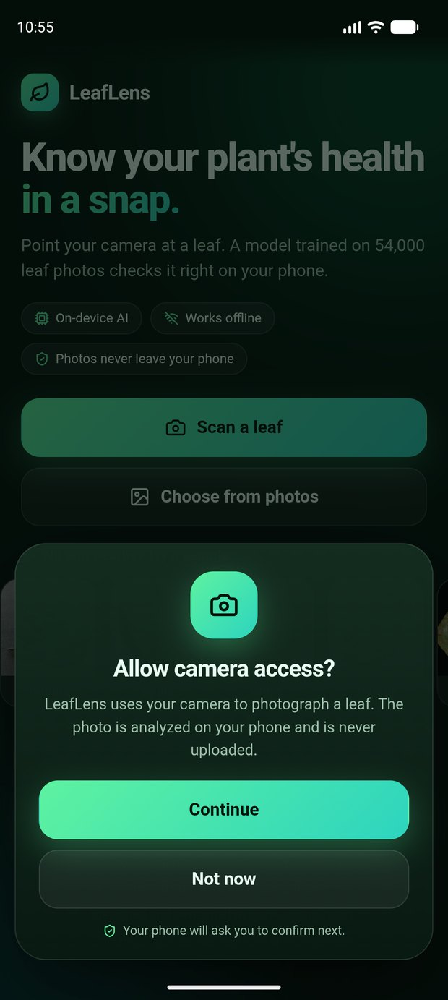
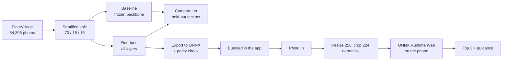
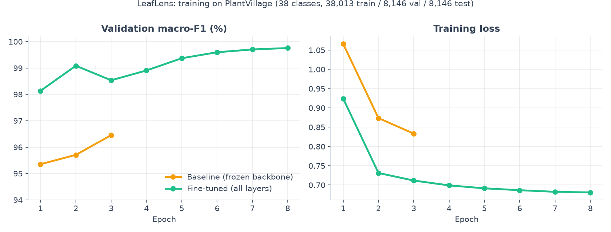

<div align="center">


# LeafLens

**Plant disease detection that runs on the phone.** Point a camera at a leaf and get an answer in a fraction of a second, with no server, no upload and no internet.

[](https://github.com/gangireddymayur/leaflens/actions/workflows/ci.yml)


<br/>






</div>

---

## Why this project

A farmer in a field often has no signal. A cloud API cannot help there, and uploading photos of someone's crop is a privacy question in its own right. LeafLens puts the trained model **inside the app**, so a scan works offline and the photo never leaves the phone.

It is also a complete machine-learning project in one repository: data preparation, training with a baseline to beat, honest evaluation, model export with a parity check, and a real iOS and Android app that ships the model.

## At a glance

| | |
|---|---|
| **Task** | Classify a leaf photo into 38 conditions across 14 crops |
| **Model** | MobileNetV3-Large (ImageNet-pretrained, fine-tuned), 17 MB as ONNX |
| **Data** | PlantVillage, 54,305 images, split 70 / 15 / 15 with a fixed seed |
| **Test result** | **99.78% accuracy, 99.58% macro-F1** on 8,146 unseen images (18 mistakes) |
| **Runs on** | iOS, Android and the browser, from one codebase (Capacitor, ONNX Runtime Web) |
| **Privacy** | Fully on-device. No network request is made during a scan |

## What the app does

- **Scan or choose:** take a photo, pick one from the library, or tap one of 8 bundled sample leaves.
- **Clear result:** the crop, the condition, a confidence ring and the next two possibilities.
- **About this condition:** for each of the 26 diseases, what causes it, how it spreads, what to look for, and general steps to manage it.
- **Honest by design:** below 60% confidence the app says it is not sure and shows no advice, and every result carries a limitations note.
- **Polite permissions:** a friendly pop-up explains why the camera is needed, then the system dialog follows.
- **Native feel:** dark, glassy interface, safe-area aware, Android back button support and a custom app icon.

## Screenshots

| iPhone | Android |
|:---:|:---:|
|   |   |
|   |   |

*Captured from the iPhone 17 Pro Max simulator and an Android (Pixel) emulator.*

## How it works



1. **Train** on a Mac or a Kaggle GPU with PyTorch. A frozen-backbone baseline comes first, so the gain from fine-tuning is measured and not assumed.
2. **Export** to ONNX and verify that the exported model gives the same answers as PyTorch (maximum difference about 3e-6).
3. **Ship** the model inside the app. The app prepares each photo exactly the way training did, runs the model locally and shows the result.

The app's JavaScript image preparation was checked against the Python pipeline on 8 held-out photos: identical predictions and the same probabilities to three decimal places.

## Results

| Model | Test accuracy | Test macro-F1 | Mistakes (of 8,146) | Training time |
|---|---|---|---|---|
| Linear baseline (frozen backbone, 3 epochs) | 97.45% | 96.23% | 208 | 4.3 min |
| **Fine-tuned (all layers, 8 epochs)** | **99.78%** | **99.58%** | **18** | 23.5 min |

Training ran on the GPU of an Apple M5 Pro (PyTorch MPS). The test split was never used for training or for choosing the checkpoint.

<p align="center"></p>

Fine-tuning helped most where the baseline struggled. The rare class `Potato · healthy` (only 152 images in the whole dataset) went from F1 66.7% to 95.5%.

<p align="center"></p>

The most common mistake of the fine-tuned model is confusing two corn leaf diseases (gray leaf spot predicted as northern leaf blight, 3 images), which look alike even to people.

<details>
<summary>Full confusion matrix</summary>
<p align="center"></p>
</details>

## Read this before trusting the numbers

Being straight about limits is part of the project.

- **The score is optimistic.** PlantVillage photos are taken on plain lab backgrounds, and the same leaf can appear in several images, so near-duplicates may sit in both the training and test splits. Real field photos will score lower, and I have **not** measured that yet.
- **Only 14 crops and 38 conditions.** It does not cover staples such as rice, wheat or cotton, and any photo that is not a leaf will still get a (meaningless) answer.
- **Confidence looks modest on purpose.** The model was trained with label smoothing, so even correct predictions show roughly 85 to 92%. That is deliberate, and it avoids overconfident answers.
- **Speed is not a phone number yet.** Timings in the app (roughly 20 to 65 ms) were measured in simulators on a Mac. A real device needs its own measurement.
- **The guidance is general information, not advice.** It is written from standard plant-pathology references and should be reviewed by an agricultural expert before real use.

## Run it

### 1. The app (the model is included)

Requires Node.js 22 or newer.

```bash
git clone https://github.com/gangireddymayur/leaflens.git
cd leaflens/app
npm install
npm run dev            # open the printed local URL in a browser
```

For a phone or emulator:

```bash
npm run build && npx cap sync
npx cap open ios       # Xcode: pick a simulator or device, press Run
npx cap open android   # Android Studio: pick an emulator or device, press Run
```

The iPhone simulator has no camera, so use **Choose from photos** or a bundled sample there. The Android emulator and real phones can use the camera.

### 2. Train the model yourself

Needs Python 3.11 or 3.12. On a Mac the Apple GPU is used automatically. On Kaggle, open `notebooks/kaggle_train.ipynb` with a GPU.

```bash
pip install uv
uv venv --python 3.12 .venv
uv pip install --python .venv/bin/python -r requirements.txt
export PYTHONPATH=src

# download a PlantVillage copy as parquet files, then turn it into class folders
.venv/bin/python -m plantdx.prepare_data --parquet-dir data/raw/hf --out-dir data/plantvillage

.venv/bin/python -m plantdx.train --data-dir data/plantvillage --mode linear   --epochs 3 --out-dir runs/linear
.venv/bin/python -m plantdx.train --data-dir data/plantvillage --mode finetune --epochs 8 --out-dir runs/finetune
```

### 3. Put your model into the app

The app needs two files in `app/public/model/`:

| File | What it is |
|---|---|
| `plant_model.onnx` | The model. One input named `input` (float32, shape `[N, 3, 224, 224]`, ImageNet mean and std normalisation) and one output named `logits` (`[N, 38]`). |
| `labels.json` | The class names, in the same order as the model's outputs. |

```bash
.venv/bin/python -m plantdx.export_onnx --checkpoint runs/finetune/best.pt --out-dir app/public/model
```

The export script checks that the ONNX file matches PyTorch before it finishes. If you change the classes, also update `app/src/lib/knowledge.js`, which holds the guidance for each condition. Rebuild with `npm run build && npx cap sync`.

### Should the model live in git?

For a 17 MB file, yes: it keeps the project runnable straight after cloning. Larger or frequently retrained models belong in **GitHub Releases** (or Git LFS), because every committed version stays in history forever. The `*.onnx` files are git-ignored except the one the app ships with.

## Project structure

```
src/plantdx/        data, training, evaluation, ONNX export (PyTorch)
tests/              unit tests for splitting and metrics
notebooks/          Kaggle training notebook
app/                the LeafLens app (React + Capacitor)
  src/lib/          on-device inference, camera, per-condition guidance
  public/model/     the ONNX model and class labels
  ios/  android/    native projects
docs/               screenshots and result charts
```

## Tests and CI

```bash
PYTHONPATH=src python -m unittest discover -s tests -v
```

CI runs the unit tests and builds the app on every push.

## Roadmap

- [x] Training, evaluation and ONNX export with a parity check
- [x] iOS and Android app with on-device inference and condition guidance
- [ ] Evaluate on real field photos and report the drop honestly
- [ ] Measure inference speed on real phones
- [ ] Evaluate the 4.5 MB int8 model on real images
- [ ] Add crops common in India (rice, wheat, cotton, chilli) with local data
- [ ] Regional language support (Telugu, Hindi)
- [ ] Review the guidance content with an agronomist

## Credits

- **PlantVillage** dataset: Hughes and Salathé, *An open access repository of images on plant health to enable the development of mobile disease diagnostics* (2015). Trained from a public CC0 copy on Hugging Face.
- **MobileNetV3**: Howard et al., *Searching for MobileNetV3* (2019), via torchvision.
- Built with PyTorch, ONNX Runtime, Capacitor, React, Vite and Framer Motion.

---

<div align="center">

**Designed and developed by [Mayur Gangireddy](https://github.com/gangireddymayur)**

© 2026 Mayur Gangireddy. All rights reserved.

</div>
